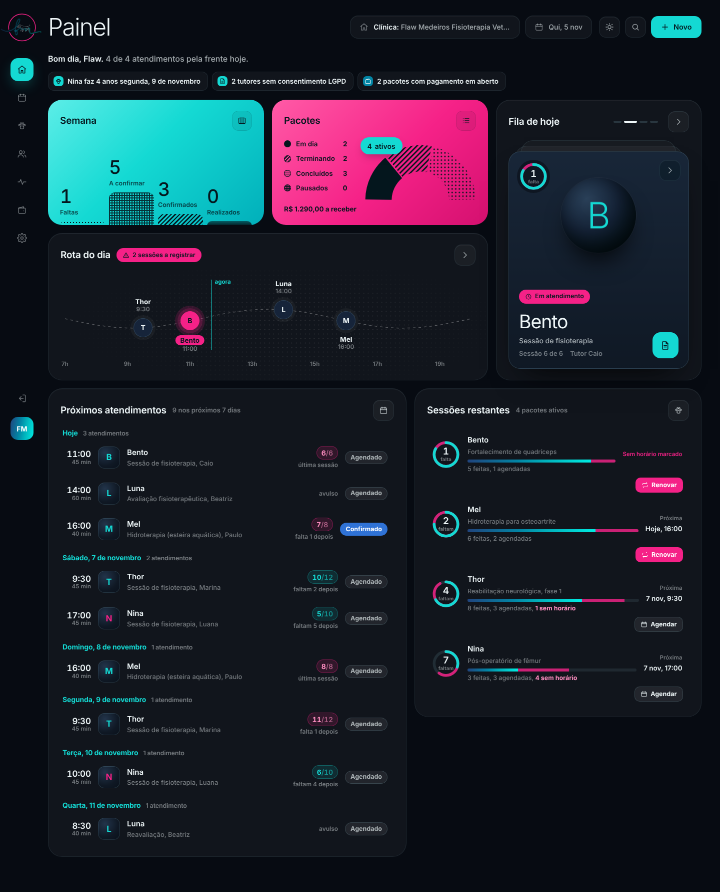
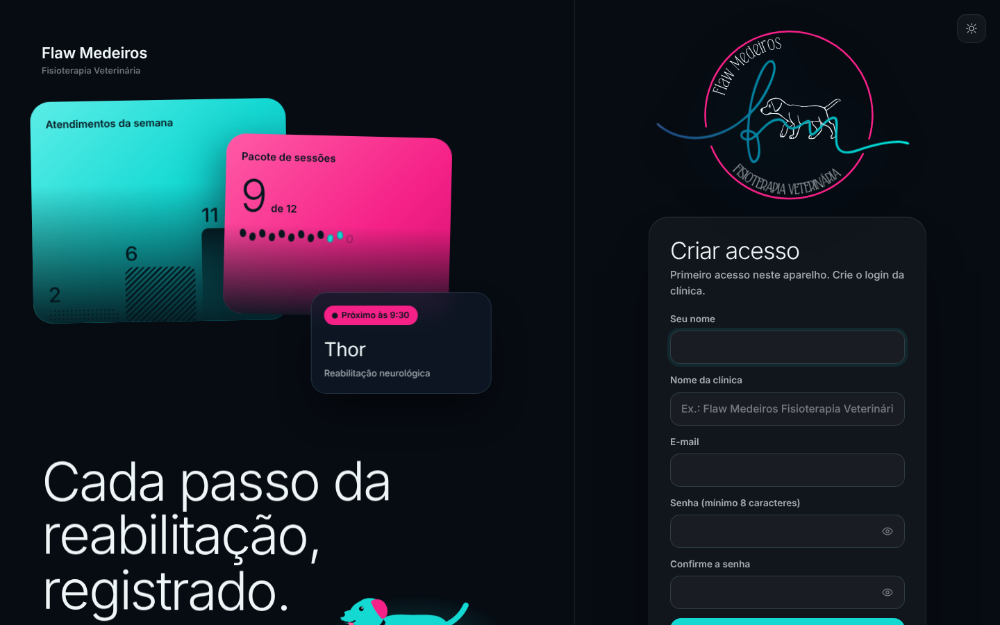
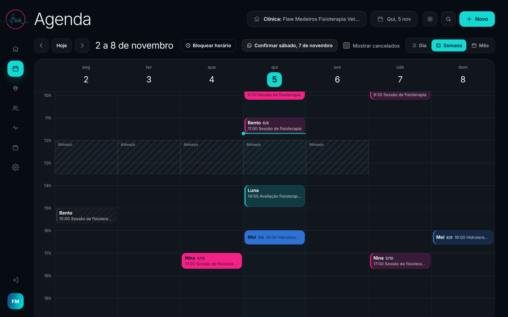
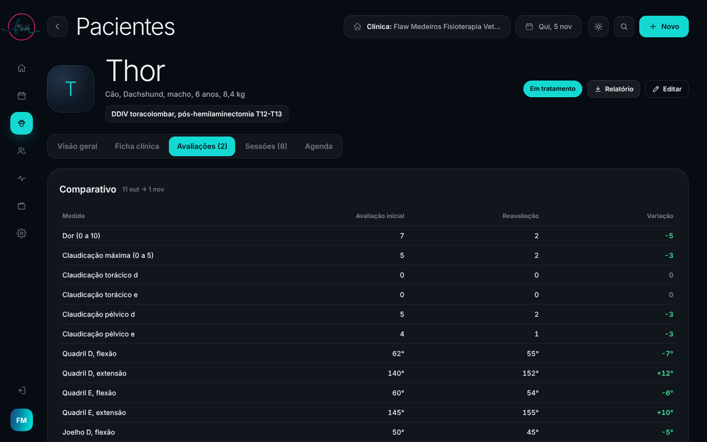
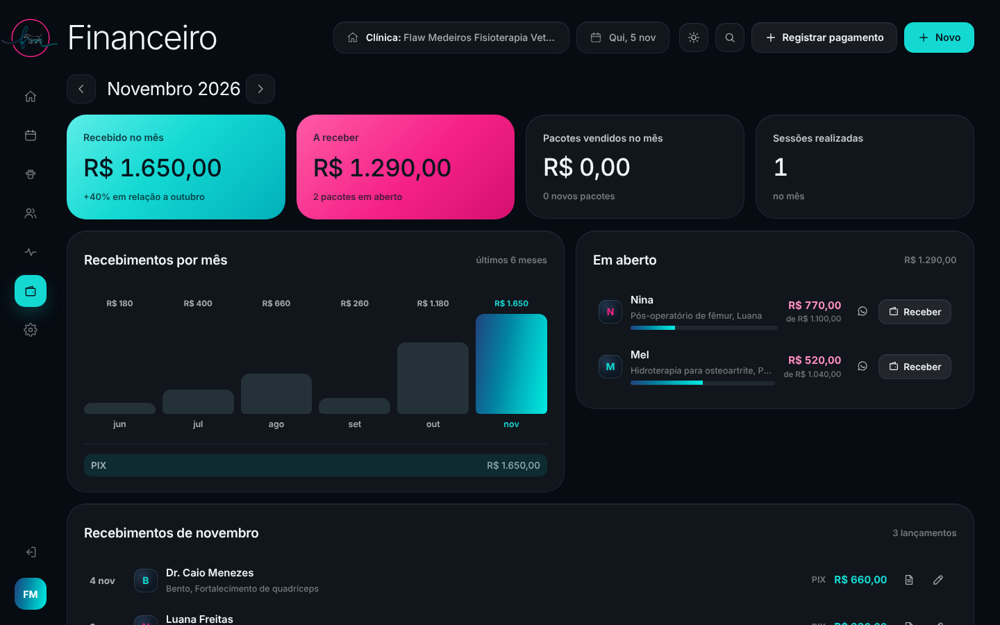
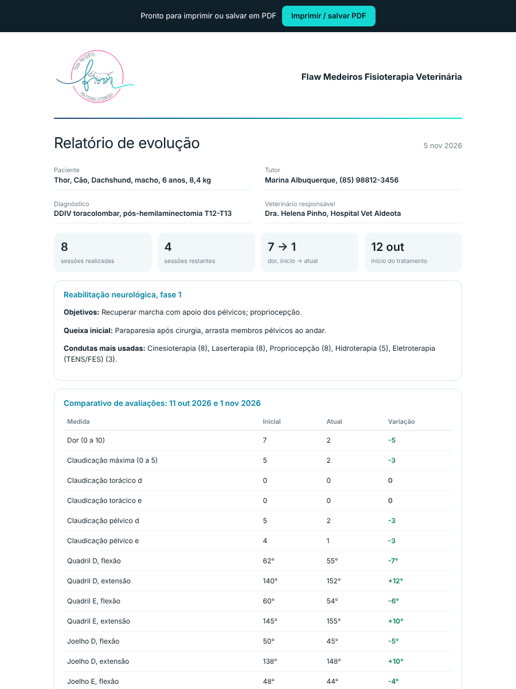

# Flaw Medeiros · Sistema da clínica de fisioterapia veterinária

Sistema web completo para uma clínica de **fisioterapia e reabilitação animal**. Ele organiza agenda, fichas de pacientes e tutores, pacotes de sessões, avaliações fisioterapêuticas, prontuário, financeiro e documentos impressos, com a identidade visual da marca **Flaw Medeiros Fisioterapia Veterinária**.

Funciona direto no navegador, sem instalação. **Os dados ficam na nuvem (Supabase)**, com login por e-mail e senha, e sincronizam entre computador e celular. Acesse pelo endereço publicado no GitHub Pages: **https://arthurkyo.github.io/flaw-medeiros-sistema/**



---

## Sumário

1. [Como usar](#como-usar)
2. [Funcionalidades](#funcionalidades)
3. [Identidade visual](#identidade-visual)
4. [Tecnologia e arquitetura](#tecnologia-e-arquitetura)
5. [Dados, segurança e LGPD](#dados-segurança-e-lgpd)
6. [Publicação no GitHub Pages](#publicação-no-github-pages)
7. [Como o projeto foi construído](#como-o-projeto-foi-construído)
8. [Próximos passos](#próximos-passos)

---

## Como usar

### Primeiro acesso
1. Abra o site e clique em **Criar conta da clínica**.
2. Informe seu nome, o nome da clínica, o e-mail e uma senha de pelo menos 8 caracteres.
3. Abra o e-mail de confirmação e clique no link. Ele traz você de volta ao site.
4. Entre com o e-mail e a senha. A mesma conta funciona em qualquer aparelho.
5. Se você esquecer a senha, use **Esqueci a senha** para receber um link por e-mail.
6. Para conhecer o sistema com dados fictícios, clique em **Ver com dados de exemplo** no Painel, ou vá em *Ajustes > Carregar dados de exemplo*. Para limpar, use *Ajustes > Apagar todos os dados*.

### No dia a dia
| Quero… | Onde |
|---|---|
| Ver o dia | **Painel**: fila de hoje, rota do dia, próximos atendimentos e sessões restantes |
| Marcar um horário | Botão **Novo** › Agendamento, ou clique num horário vazio da agenda |
| Agendar o pacote inteiro | No agendamento, marque **Agendar o pacote inteiro** e escolha os dias da semana |
| Remarcar | Na agenda semanal, **arraste** o atendimento para outro horário |
| Registrar a sessão | Clique no atendimento › **Registrar sessão** (desconta do pacote) |
| Confirmar os horários de amanhã | Agenda › **Confirmar amanhã** (mensagem pronta no WhatsApp) |
| Registrar um pagamento | **Financeiro** › Registrar pagamento (gera recibo) |
| Mandar a evolução ao tutor ou ao veterinário | Ficha do pet › **Relatório** (imprimir ou salvar em PDF) |
| Achar alguém rápido | **Ctrl+K** (⌘K no Mac) ou a lupa no topo |
| Trocar entre claro e escuro | Botão sol/lua no topo (também no login) |

---

## Funcionalidades

### Login
- **Conta na nuvem (Supabase Auth)**: criar conta com confirmação por e-mail, entrar em qualquer aparelho e recuperar a senha por link.
- **Equipe**: a dona adiciona uma secretária pelo e-mail em *Ajustes › Equipe*, e as duas veem a mesma agenda e as mesmas fichas.
- Indicador no topo: *Sincronizado*, *Salvando* ou *Offline*. Sem internet, tudo fica salvo no aparelho e é enviado quando a conexão volta.
- Sem a nuvem configurada, o sistema funciona em modo local, com senha protegida por hash SHA-256 com salt e código de recuperação.
- Tela animada com o logo da marca (a mesma sequência do vídeo oficial), cards flutuantes, contagem de números e um cachorrinho correndo.



### Painel
- **Semana**: faltas, a confirmar, confirmados e realizados, em barras texturizadas.
- **Pacotes**: meia rosca com os pacotes em dia, terminando, concluídos e pausados, mais o total a receber.
- **Fila de hoje**: cartão do próximo paciente com um anel de sessões restantes. Os tracinhos no topo navegam pela fila.
- **Rota do dia**: linha do tempo com cada atendimento e o horário atual.
- **Próximos atendimentos**: os próximos 7 dias agrupados por dia, com o número da sessão (por exemplo, 9/12) e quantas faltam depois dela.
- **Sessões restantes**: um anel por paciente, avisando quando há sessões sem horário e quando é hora de renovar o pacote.
- **Avisos**: confirmações pendentes, aniversários dos pets, pacientes sem retorno, pagamentos em aberto e tutores sem consentimento LGPD.
- Animações de entrada só quando a tela é aberta: números contando, gráficos se desenhando e blocos em cascata.

### Agenda
- Visões de **dia**, **semana** e **mês**.
- Clique num horário vazio para agendar; **arraste** para remarcar (com aviso de conflito).
- **Bloqueios de horário** (almoço, férias, feriado), só numa data, toda semana ou em todos os dias úteis.
- Aviso de conflito com outros atendimentos e com bloqueios.
- **Agendar o pacote inteiro**: escolhe os dias da semana e a quantidade, mostra as datas antes de salvar e pula os horários ocupados.
- **Confirmar amanhã**: lista o próximo dia com atendimentos e traz uma mensagem pronta no WhatsApp para cada tutor.
- Situações: agendado, confirmado, realizado, faltou e cancelado. A falta não desconta do pacote.



### Pacientes e tutores
- Ficha completa do pet: foto, espécie, raça, sexo, idade, peso, porte, castração, microchip, diagnóstico, queixa, histórico, cirurgias, medicações, alergias, exames, veterinário que encaminhou, temperamento e cuidados no manejo.
- Ficha do tutor: contatos, preferência de contato, endereço com link para o mapa, contato de emergência, origem do cliente, resumo financeiro e faltas.
- Tutor cadastrado direto no formulário do pet, quando é novo.
- Botões de WhatsApp, ligar e e-mail em todas as fichas.

### Avaliação fisioterapêutica estruturada
- Dor (0 a 10), peso, escore corporal (1 a 9) e comportamento na avaliação.
- **Claudicação** (0 a 5) e **propriocepção** em cada membro.
- **Goniometria** (flexão e extensão, direita e esquerda) de ombro, cotovelo, carpo, quadril, joelho e tarso.
- **Perimetria** de coxa e braço; reflexos patelar, flexor e cutâneo do tronco; dor profunda.
- Marcha, testes especiais e conduta.
- **Comparativo automático** entre a primeira e a última avaliação, com a variação destacada em verde (melhora) ou rosa (piora).



### Pacotes, sessões e prontuário
- Plano de tratamento: quantidade de sessões, frequência, valor, entrada, forma de pagamento e objetivos.
- **Trilha de pegadas** e anéis mostrando as sessões feitas, agendadas e que faltam.
- O pacote é concluído automaticamente na última sessão, com o botão **Renovar**.
- Evolução de cada sessão: dor, mobilidade, técnicas aplicadas, evolução e orientações para casa.
- **Gráfico de evolução** da dor e da mobilidade.

### Financeiro
- Recebido no mês (com a comparação com o mês anterior), a receber, pacotes vendidos e sessões realizadas.
- Gráfico dos últimos 6 meses e divisão por forma de pagamento.
- Lista de valores em aberto, com cobrança gentil pronta no WhatsApp.
- Pagamentos parcelados por pacote e **recibo numerado** para imprimir ou salvar em PDF.



### Documentos impressos
- **Relatório de evolução**: logo, dados do pet e do tutor, números principais, comparativo de avaliações, gráfico e todas as sessões.
- **Recibo** de pagamento.
- **Termo de consentimento LGPD** para o tutor assinar.



### Outros
- **Busca rápida** (Ctrl+K) por paciente, tutor, telefone e ações.
- **Modo claro e escuro**, com a escolha salva no navegador.
- **Backup**: exportar e importar todos os dados em JSON.
- **Ajustes**: dados da clínica, horário da agenda, serviços (duração, preço e cor), conta e senha.
- **Responsivo**: no celular, barra inferior flutuante e janelas que abrem de baixo para cima. Pode ser instalado na tela inicial.
- Acessibilidade: foco visível no teclado, rótulos para leitores de tela e respeito à preferência de "reduzir movimento".

---

## Identidade visual

| Elemento | Valor |
|---|---|
| Magenta do círculo | `#F52187` |
| Fita "fm" (degradê) | `#20437D` → `#0284A4` → `#01AFBA` → `#00ECE2` |
| Acento principal da interface | aqua `#14D9D3` (escuro) / `#12BDBD` (claro) |
| Fundo escuro | `#070B12` |
| Fundo claro | `#F4F7F9` |
| Fonte | [Urbanist](https://fonts.google.com/specimen/Urbanist): títulos finos (300), interface média (500 e 600) |

- O **logo** foi vetorizado a partir do PDF oficial da marca (`assets/js/brand.js`). A fita, que no PDF é uma imagem, foi refeita como degradê vetorial com as cores extraídas do arquivo.
- A **animação do logo** reproduz a ordem do vídeo da marca: o círculo se desenha, o nome aparece, a fita escreve o "fm", surge o texto de baixo, o cachorro aparece e depois fica caminhando.
- A linguagem visual (vidro fosco, cards coloridos com texturas pontilhadas e listradas, barra lateral com ícones) foi inspirada no shot *Netsuite CRM* da RonDesignLab no Dribbble, e adaptada às cores da marca.

---

## Tecnologia e arquitetura

**Sem frameworks e sem etapa de build.** É HTML, CSS e JavaScript puros, em scripts clássicos, para funcionar abrindo o arquivo direto (`file://`) e também no GitHub Pages.

```
index.html                 entrada; carrega CSS, fonte e scripts na ordem certa
manifest.webmanifest       instalação como app (PWA)
assets/
  favicon.svg
  css/app.css              todo o visual: tokens, componentes, animações, modo claro
  js/store.js              camada de dados (localStorage), consultas e autenticação
  js/ui.js                 utilitários: datas, máscaras, modais, avisos, ícones SVG, contagem animada
  js/brand.js              logo Flaw Medeiros em SVG (versões completa, recortada e mini)
  js/forms.js              formulários: tutor, paciente, plano, agendamento, sessão, serviço
  js/views.js              telas: painel, agenda, pacientes, ficha, tutores, sessões, ajustes
  js/features.js           financeiro, recibo, relatório, confirmações, busca, agendamento do pacote
  js/clinic.js             avaliação fisioterapêutica, LGPD, bloqueios, visão mensal, arrastar
  js/cloud.js              nuvem: login Supabase, sincronização por diferença, fila offline, equipe
  js/config.js             URL e chave pública do Supabase (deixe vazio para modo local)
  js/app.js                rotas, menu, login, tema, dados de exemplo
supabase/schema.sql        tabelas, funções e regras de segurança (RLS) do banco
docs/
  ARQUITETURA.md           detalhes técnicos e modelo de dados
  screenshots/             imagens usadas neste README
```

- **Rotas por hash** (`#/painel`, `#/agenda`, `#/pacientes/:id`…), que funcionam no GitHub Pages sem configuração.
- **Renderização**: cada tela devolve `{ title, html, mount }`. Depois de qualquer alteração nos dados, a tela é redesenhada; as animações de entrada rodam só na navegação.
- **Dados**: em memória, com uma cópia no aparelho (`localStorage`), divididos nas coleções `tutors`, `pets`, `plans`, `appointments`, `sessions`, `payments`, `evaluations`, `blocks` e `services`.
- **Nuvem**: cada registro vira uma linha da tabela `records` (`clinic_id`, `coll`, `id`, `data jsonb`, `deleted`, `updated_at`).
  - Cada alteração é comparada com a última versão enviada, e só o que mudou sobe, em lotes.
  - A cada 30 segundos, e quando a janela volta ao foco, o sistema baixa o que mudou desde a última sincronização.
  - Exclusões são marcadas com `deleted = true`, para chegarem também aos outros aparelhos.
- **Segurança da nuvem**:
  - *Row Level Security*: cada usuário só lê e grava os registros da clínica em que é membro.
  - A chave usada no site é a **publishable** (pública por natureza); sem login, ela não dá acesso a nenhum dado.

O modelo de dados completo está em [docs/ARQUITETURA.md](docs/ARQUITETURA.md).

---

## Dados, segurança e LGPD

- **Os dados ficam no Supabase** (região São Paulo), protegidos por login e por regras de acesso no banco.
- **O plano gratuito do Supabase não faz backup automático.** Exporte o backup de vez em quando (Ajustes › Exportar backup) e guarde-o num local seguro.
- No plano gratuito, **o projeto pausa depois de 7 dias sem uso**. Se a clínica ficar fechada por mais tempo, reative em supabase.com › projeto › *Restore*.
- As senhas são guardadas pelo Supabase Auth, nunca no código do site.
- No primeiro login de um aparelho que já tinha dados no modo local, o sistema pergunta se deve enviá-los para a conta.
- **LGPD**:
  - registro do consentimento do tutor, com data;
  - autorização separada para mensagens;
  - termo de consentimento para imprimir;
  - página de privacidade;
  - **exportar os dados** de um tutor;
  - **anonimizar** um tutor que pedir a exclusão (o histórico clínico fica guardado sem identificação).

---

## Publicação no GitHub Pages

O site é 100% estático. No repositório:

1. Acesse **Settings › Pages**.
2. Em *Build and deployment*, escolha **Deploy from a branch**, depois a branch **main** e a pasta **/ (root)**.
3. Em cerca de 1 minuto, o site fica disponível em `https://<seu-usuario>.github.io/<repositorio>/`.

O arquivo `.nojekyll` garante que o GitHub sirva todos os arquivos exatamente como estão.

> No GitHub Pages, os dados de cada pessoa continuam salvos só no navegador de quem acessa. Publicar o site não expõe nenhum dado de paciente.

---

## Como o projeto foi construído

O sistema foi feito em etapas, a partir dos pedidos da cliente:

1. **Base funcional**: CRM com agendamentos, sessões, contagem de sessões restantes, ficha do pet, ficha do tutor e login responsivo.
2. **Redesenho no nível de um produto SaaS**: inspirado na referência do Dribbble, com painel em blocos, vidro fosco, texturas e fonte Urbanist.
3. **Login animado**: letras e cards em movimento contínuo e paralaxe com o mouse.
4. **Cachorrinho correndo** no fundo do login, desenhado em SVG e animado só com CSS (galope com dois segmentos por pata, orelha, rabo, poeira e pegadas).
5. **Marca Flaw Medeiros**: logo vetorizado do PDF, animação recriada a partir do vídeo da marca e paleta aplicada no sistema inteiro.
6. **Painel mais claro**: anéis de sessões restantes, próximos atendimentos agrupados por dia e números animados.
7. **Recursos de valor**: agendamento do pacote inteiro, financeiro com recibo, confirmações por WhatsApp, relatório de evolução, busca rápida e avisos.
8. **Modo claro e escuro**.
9. **Recursos clínicos e legais**: avaliação fisioterapêutica estruturada com comparativo, LGPD, bloqueios de agenda, visão mensal e arrastar para remarcar.
10. **Nuvem**: login real e sincronização entre aparelhos com o Supabase, mais a gestão de equipe.

Cada etapa foi testada de ponta a ponta com um navegador automatizado (Playwright): criar acesso, entrar, carregar os dados de exemplo, agendar, registrar sessão e conferir a contagem do pacote, pagamento e recibo, relatório, arrastar na agenda e trocar o tema. Os testes rodaram no computador e no celular (iPhone 13), sem erros de JavaScript.

---

## Próximos passos

| Prioridade | Item | Depende de |
|---|---|---|
| Alta | Domínio próprio (ex.: `sistema.flawmedeiros.com.br`) | Domínio da clínica |
| Média | Fotos e vídeos de marcha anexados à ficha | Armazenamento na nuvem (Supabase Storage) |
| Média | Lembretes automáticos por WhatsApp (API oficial) | Conta no WhatsApp Business API |
| Baixa | Portal do tutor para ver a evolução e os horários | Backend na nuvem |

### Como recriar o banco num projeto Supabase novo
1. Crie o projeto (região São Paulo).
2. No **SQL Editor**, cole e rode `supabase/schema.sql`.
3. Em *Authentication › URL Configuration*, coloque o endereço do site em **Site URL** e em **Redirect URLs** (com `/**` no final).
4. Coloque a Project URL e a chave *publishable* em `assets/js/config.js`.

---

© Flaw Medeiros Fisioterapia Veterinária. Todos os direitos reservados. Código e marca de uso exclusivo da clínica.
